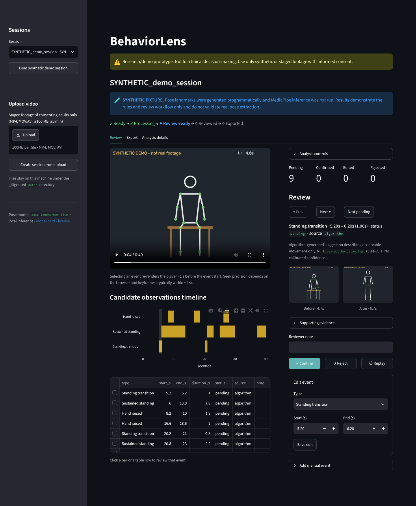
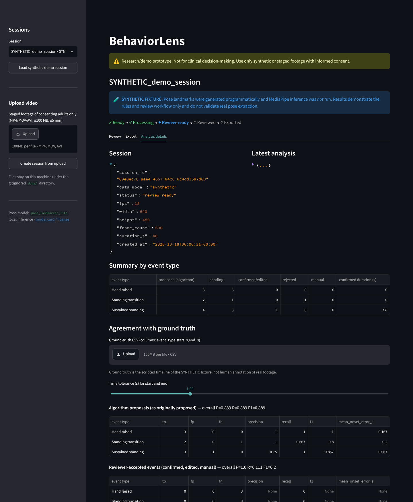

# BehaviorLens

> **Research/demo prototype. Not for clinical decision-making. Use only synthetic or staged footage with informed consent.**

BehaviorLens is a local-first, computer-vision-assisted review tool for videos of **staged** behavioral sessions. It runs MediaPipe pose estimation on an uploaded video and applies interpretable temporal rules to suggest **candidate observable movement events** (`hand_raised`, `standing_transition`, `sustained_standing`) on a timeline. A human reviewer then confirms, rejects, edits or adds events and exports the reviewed records as CSV/JSON.

Everything runs on your machine. Videos are never uploaded anywhere, and the app makes no telemetry or LLM calls. The app listens on `localhost` only (`.streamlit/config.toml`), so other machines on your network can't reach it, and startup makes no outbound requests. The only network access is the one-time download of the pose model, plus the optional real-video validation scripts that fetch research clips.

The full specification is in [`docs/PRD.md`](docs/PRD.md).



## What it does and doesn't do

| Does | Doesn't |
|---|---|
| Detect visually observable movement patterns with transparent rules | Diagnose, assess severity, or infer emotion, intent or behavioral function |
| Show the evidence and parameters behind every suggestion | Output calibrated probabilities (`confidence` is always `null`) |
| Mark frames as *unobservable* when landmarks are missing | Guess when hips/knees/wrists aren't visible |
| Keep every reviewer decision with an audit trail | Recommend treatment, or claim HIPAA/FDA/clinical validity |

## Quick start

Tested with **Python 3.11** on Linux.

```bash
git clone https://github.com/ashaankjha/behaviorlens.git
cd behaviorlens
python3.11 -m venv .venv && source .venv/bin/activate
pip install -r requirements.txt -c constraints.txt   # exact tested versions; add -r requirements-dev.txt for ruff/playwright

# Linux only: MediaPipe needs EGL/GLES system libraries
sudo apt-get install -y libegl1 libgles2

# One-time download of the pose model (~6 MB from Google's MediaPipe model bucket)
python scripts/download_model.py

streamlit run app.py          # serves http://localhost:8501 (headless: open it in your browser)
```

Run the tests:

```bash
pytest -q
```

Without the model, everything except real-video inference still works: the synthetic demo, review, export, and most tests. The two real-inference tests also download MediaPipe's public sample photos of adults to a temporary directory. They are skipped when offline.

## Demo workflow (2 minutes)

1. Click **Load synthetic demo session** in the sidebar. This loads a 40 s **synthetic** session: programmatically generated pose landmarks plus a stick-figure video. It is clearly labelled, and MediaPipe is *not* run on it.
2. Click a bar on the timeline, or a row in the table, to select an event. The player jumps to about 1 s before the event.
3. Check the before/after thumbnails and open **Supporting evidence** to see why the rule fired. Then **Confirm**, **Reject**, or edit the type and times. Edits keep the original proposal.
4. Use **Add manual event** for anything the rules missed.
5. **Export**: download CSV/JSON. Rejected events are kept, with their status, unless you filter them out.
6. **Analysis details**: observability warnings, per-type summary, and agreement with the scripted ground truth. The demo includes one deliberate miss: a stand-up that happens while the legs are hidden behind a desk.

To try a real video, upload a short MP4/MOV/AVI (≤100 MB, ≤5 min) of a **consenting adult**, then click **Run analysis**. For real videos you can also render a low-resolution **pose overlay** preview.



### Optional: test with your own staged clip (about 5 minutes)

The synthetic demo bypasses inference. To check real pose extraction end to end:

1. With the consent of the adult being filmed, record a 20–40 s clip on a phone. Frame one person from the front, full body visible, in an uncluttered room.
2. Act out the following, ideally with a stopwatch running:
   - sit on a chair for about 5 s
   - stand up and stay standing for about 5 s
   - raise your right hand for about 2 s, then lower it
   - flick a hand up for under half a second (this should *not* produce an event)
   - sit down (this should *not* produce a `standing_transition`)
3. Upload the clip, click **Run analysis**, then **Render pose overlay preview** to check the skeleton tracks the body.
4. Write the true times to a CSV with columns `event_type,start_s,end_s` and upload it under **Analysis details → Agreement with ground truth**. You'll see precision and recall with a configurable time tolerance.
5. Delete the session when you're done. Don't commit the clip.

### Real-video validation

```bash
python scripts/fetch_validation_clips.py        # Charades and UCF101 research samples -> data/validation/ (never committed)
python scripts/validate_real_video.py --split holdout
```

Results and protocol are in [`docs/VALIDATION.md`](docs/VALIDATION.md). On held-out Charades clips (consenting adults acting out home scripts), v0.2 finds 4/10 stand-ups with precision 0.40, against 2/10 for v0.1. Most misses are stand-ups where the legs are hidden.

Every PRD requirement and acceptance test is mapped to its implementation and test in [`docs/PRD_TRACEABILITY.md`](docs/PRD_TRACEABILITY.md).

## Event definitions (rules-v0.2)

All thresholds are engineering heuristics, adjustable under **Analysis controls**. They are not validated clinical criteria.

- **`hand_raised`**: a wrist is above the same-side shoulder by at least 0.5 *head units* (the vertical nose-to-shoulder-line distance, so it doesn't depend on image size) for at least 0.6 s. Shoulders, wrists and nose must be visible (MediaPipe visibility ≥ 0.5) and inside the frame. Both hands raised together count as one event with `side: "both"`.
- **`standing_transition`**: a stable seated-like run followed, within 5 s, by a stable standing-like run, each held for at least 0.8 s.
  - *Seated-like*: hips flexed (shoulder–hip–knee angle ≤ 140°), **or** knees bent (≤ 130°, when ankles are visible), **or** both thighs foreshortened or horizontal (hip-to-knee drop ≤ 0.35 × torso length, the front-on camera cue). In every case, neither leg hangs straight down.
  - *Standing-like*: hips extended (≥ 150°), both thighs pointing down (drop ≥ 0.3), torso within 35° of vertical, and knees straight if the ankles are visible.
  - Shoulders, hips and knees must be visible **and inside the frame**. Upper-body visibility alone never implies sitting.
- **`sustained_standing`** (optional, P1): a standing-like run of at least 2 s.
- **Camera motion**: landmarks are image coordinates, so a pan, tilt or zoom changes apparent posture. Global background motion between sampled frames is estimated with OpenCV (person region excluded), and frames where the camera moves faster than 0.2 frame widths/s, 10°/s or 10 % zoom/s are **unobservable for posture**. Hand rules are not masked. Shown as a grey *Camera motion* lane on the timeline and as a warning; see [`docs/VALIDATION.md`](docs/VALIDATION.md#camera-motion).

v0.2's posture thresholds were chosen on real video (Charades) and checked on a held-out half; see [`docs/VALIDATION.md`](docs/VALIDATION.md) for the numbers and limits. v0.1's synthetic-tuned thresholds caught fewer than half of real seated frames.

Pipeline: per-frame features → tri-state candidate states (true / false / unobservable) → bridging of gaps up to 0.4 s → temporal segments → minimum-duration filters → events carrying `evidence`, `algorithm_version` and rule parameters.

## Architecture

```
Local video ─► validation (extension, size, container signature, fps, duration)
            ─► OpenCV sequential decode, sampled at 5 fps (or 10) from source frame indices
            ─► MediaPipe Pose Landmarker (VIDEO mode, local .task model)
            ─► features.py ─► event_rules.py ─► suggested events
            ─► SQLite (sessions, analyses, events, review_history) + .npz landmark files
            ─► Streamlit review UI ─► CSV / JSON export
```

```
app.py                       Streamlit UI (single entrypoint)
src/behaviorlens/
  config.py                  paths, limits, RuleParams
  models.py                  PoseSequence, Event (pydantic), VideoMeta
  video_io.py                upload validation, probing, frame sampling, H.264 previews
  pose.py                    MediaPipe wrapper and model download
  features.py                per-frame geometry and tri-state candidate states
  camera_motion.py           global camera-motion estimate per sampled frame (pans, zooms)
  event_rules.py             temporal rules producing events with evidence
  pipeline.py                session creation, analysis orchestration, pose cache, overlay
  storage.py                 SQLite persistence, review actions, audit log
  export.py                  CSV/JSON export
  metrics.py                 tolerance-based agreement with ground truth
  demo_generator.py          SYNTHETIC fixture, ground truth and stick-figure video
scripts/download_model.py    fetch the pose model
scripts/generate_demo.py     regenerate sample_data/ (deterministic)
sample_data/                 synthetic fixture only (no real people)
tests/                       pytest suite (rules, storage, export, pipeline, UI smoke test)
data/                        local storage: DB, videos, derived files (gitignored)
```

Design notes:

- **Re-running analysis** replaces only *unreviewed* suggestions, and only after the reviewer ticks a confirmation box. Confirmed, rejected, edited and manual events are kept. New suggestions that overlap an already-reviewed event of the same type are skipped rather than duplicated. Each run is stored as a new `analysis_id`.
- **Pose results are cached** by content checksum, model version and sampling rate, so changing rule thresholds re-runs only the cheap rule stage.
- **Idempotent review actions**: every UI action carries a request ID, and replays caused by Streamlit reruns are ignored.
- **Browser playback**: uploads that aren't already H.264 MP4 are transcoded locally to an H.264 preview with the bundled `imageio-ffmpeg` binary.

## Privacy and limitations

- The server binds to `localhost`. To deliberately expose it on a trusted network, run `streamlit run app.py --server.address 0.0.0.0`. Uploaded videos and reviews then become reachable by anyone who can reach that address.
- Processing is local. Streamlit usage statistics are disabled in `.streamlit/config.toml`. Logs never contain frames or identifying information.
- Uploads and derived files live under the gitignored `data/sessions/<session_id>/`. **Delete session** removes the database rows, review history, stored video, landmarks and overlay, plus the pose cache unless another session uses the same video. Backups made outside the app are outside its control.
- Exports never include video, file paths, source filenames (which may contain names) or images. They carry a "not clinically validated" warning and a `data_mode` (`synthetic` or `video_inference`).
- Single primary person only. If several people are detected, the largest pose is used and a warning is shown, because attribution is unreliable.
- A moving camera makes posture unobservable while it moves, so a stand-up filmed by a camera that follows the person is usually not suggested. Slow drift below the thresholds is not detected as motion.
- 2D heuristics depend on camera angle. Side views, crouching, lunges and partial occlusion can produce *ambiguous* or *unobservable* frames, which by design yield no event.
- Seek precision depends on the browser and video keyframes (typically within ~1 s). Previews are H.264, which Chrome, Edge, Safari and Firefox play. Some open-source Chromium builds lack H.264 decoding.
- The synthetic demo exercises the rules and the UI. It **does not** validate real pose extraction.
- MediaPipe model: `pose_landmarker_lite`, distributed by Google under the terms in its [model card](https://developers.google.com/edge/mediapipe/solutions/vision/pose_landmarker#models). It is downloaded, not committed.

## Reference docs

- MediaPipe Pose Landmarker (Python): https://developers.google.com/edge/mediapipe/solutions/vision/pose_landmarker/python
- Streamlit `st.video`: https://docs.streamlit.io/develop/api-reference/media/st.video
