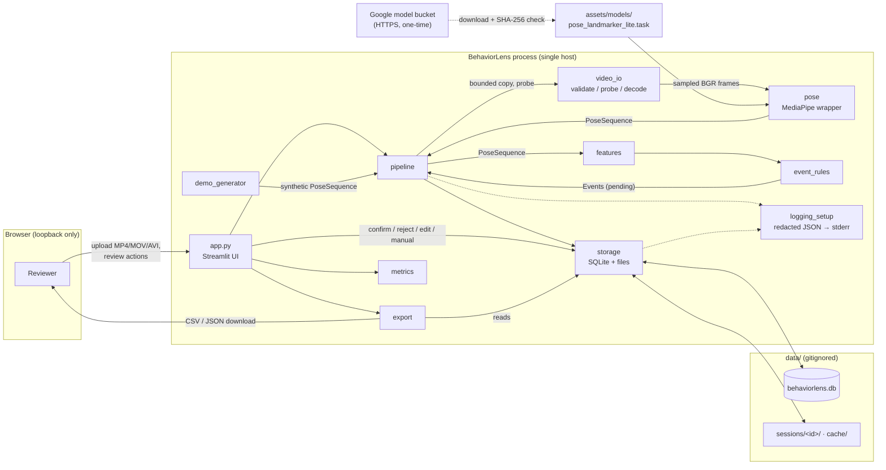

# Software Architecture

> **DRAFT — requires review by qualified regulatory/QA personnel; not a regulatory submission.**

| Field | Value |
|---|---|
| Document ID | BL-REG-ARCH-001 |
| Version | 0.1 (draft) |
| Date | 2026-10-20 |
| Status | Draft |
| Owner | TBD (manufacturer) |
| Applies to | BehaviorLens `0.1.0`, `rules-v0.2`, schema version 2 |

Related documents: [Intended use](intended_use.md) · [Software development plan](software_development_plan.md) · [Software requirements](software_requirements.md) · [SOUP list](soup_list.md) · [Risk management](risk_management.md) · [Cybersecurity](cybersecurity.md) · [Verification report](verification_report.md)

---

## 1. Purpose

This document describes the software items of BehaviorLens, how data flows between them, where data is stored, the trust boundaries, and which items wrap third-party software (SOUP). It is intended to support the architectural-design activity described in [software_development_plan.md](software_development_plan.md) §5 and the risk analysis in [risk_management.md](risk_management.md).

## 2. System context

BehaviorLens is a single-process Python 3.11 application. A Streamlit server renders the UI in the user's browser over loopback. All processing (decode, pose inference, rules, storage, export) happens in the same process on the local machine. The only network access by the application is the one-time pose-model download from Google's MediaPipe model bucket over HTTPS.

Deployment options: (a) `streamlit run app.py` in a virtualenv installed with `-c constraints.txt`; (b) the `Dockerfile` image (non-root user, data volume at `/data`, port published to `127.0.0.1`). The container `CMD` passes `--server.address=0.0.0.0`, `--browser.gatherUsageStats=false` and `--logger.hideWelcomeMessage=true`; the last flag stops Streamlit 1.66's `bootstrap._print_url` from fetching `checkip.amazonaws.com` when bound to a wildcard address. The image is built and smoke-tested by the CI `docker` job only; it was not built locally while drafting this document.

## 3. Software items

| Item | File | Responsibility | Depends on (internal) | SOUP used |
|---|---|---|---|---|
| UI | `app.py` | Streamlit layout, callbacks, disclaimer, review controls, export downloads, integrity display. Holds no business rules beyond input wiring. | config, pipeline, storage, export, metrics, pose, models, logging_setup | Streamlit, Plotly, pandas |
| Configuration | `src/behaviorlens/config.py` | Paths, limits (size, duration, fps, pixels, decoded frames), `ALGORITHM_VERSION`, model URL and SHA-256, `RuleParams`, disclaimer and export warning text. | — | stdlib |
| Data model | `models.py` | `PoseSequence` (N×33×5 landmarks, invariants, `.npz` I/O), `Event` (pydantic, interval validation), `VideoMeta`, `AnalysisResult`. | config | numpy, pydantic |
| Video I/O | `video_io.py` | Upload validation (extension, size, container signature), filename sanitizing, probing and limits, frame sampling and sequential decode, SHA-256, H.264 preview transcode, `FrameWriter`. | config, models | OpenCV, imageio-ffmpeg (ffmpeg binary), numpy |
| Pose | `pose.py` | Model download with SHA-256 verification, load-time re-verification of a default-path model (`ModelIntegrityError`), model version string, MediaPipe VIDEO-mode wrapper, primary-person selection. | config, models | MediaPipe, OpenCV, numpy, `urllib` |
| Features | `features.py` | Per-frame tri-state features: hand-raise margins (head units), posture state (seated/standing/ambiguous/unknown) with visibility and in-frame gating. | config, models | numpy |
| Event rules | `event_rules.py` | Segmenting, gap bridging, minimum durations, dwell logic; builds `Event`s with evidence and parameters; observability statistics. | config, features, models | numpy |
| Pipeline | `pipeline.py` | Orchestration: create upload/demo sessions, bounded upload copy, pose extraction, caching, `analyze_pose` (warnings + rules), `run_analysis`, overlay rendering, thumbnails. | all core items | OpenCV, numpy |
| Storage | `storage.py` | SQLite schema, migrations, transactions, sessions/analyses/events, review actions with idempotency, hash-chained audit trail, `verify_integrity`, deletion log, file layout under the data dir. | config, models | sqlite3 (stdlib) |
| Export | `export.py` | CSV and JSON of reviewed events, with provenance, warning and audit chain head; excludes paths, filenames, video and images. | config, models, storage | csv, json (stdlib) |
| Metrics | `metrics.py` | Ground-truth CSV parsing and validation; tolerance-based one-to-one matching; precision/recall/F1. | config | csv (stdlib) |
| Demo generator | `demo_generator.py` | Deterministic synthetic pose sequence, ground truth and stick-figure video (`data_mode="synthetic"`). | config, models | numpy, OpenCV, imageio-ffmpeg (via `video_io.FrameWriter`) |
| Logging | `logging_setup.py` | JSON-lines logger to stderr with path redaction, field cleaning and exception-type-only reporting. | config | logging (stdlib) |

Supporting, not shipped in the runtime path: `scripts/download_model.py` (CLI wrapper of `pose.download_model`), `scripts/generate_demo.py`, `scripts/fetch_validation_clips.py` and `scripts/validate_real_video.py` (real-video evaluation; fetch research clips into `data/validation/`).

## 4. Data flow



### 4.1 Main sequences

1. **Upload:** `validate_upload` (extension, size, signature) → `_copy_bounded` into `sessions/_incoming/<uuid>` (aborts above 100 MB regardless of declared size) → `probe_video` (decodable, 1–240 fps, 1 s–5 min, ≤ 4K) → SHA-256 → `create_session` → move to `sessions/<id>/source.<ext>` → H.264 preview if needed. Any failure removes the temp file and the partial session.
2. **Analysis:** `run_analysis` sets `processing` → loads the synthetic fixture, or probes the video, opens the estimator and loads the pose cache or runs `extract_pose` (sequential decode, ≤ 72,000 frames, per-frame 4K check) → `analyze_pose` (observability warnings + `detect_all`) → `add_analysis` (settings, stats, warnings, model and algorithm version, landmarks `.npz`) → `save_suggestions` (replace pending only) → `review_ready`. On error, the session is marked `failed` (or keeps its reviewed status) and the exception type is logged.
3. **Review:** each UI action carries a `request_id`; `_apply_review` runs in `BEGIN IMMEDIATE`, skips duplicates, rewrites the event, appends a hash-chained `review_history` row, and refreshes session status.
4. **Export:** `to_csv` / `to_json` read events and session metadata, run `verify_integrity`, and include the chain head; `mark_exported` advances status only if nothing is pending.
5. **Delete:** `delete_session` records a `deletion_log` row, deletes DB rows (cascade; connections use `PRAGMA secure_delete = ON`, so deleted content is overwritten in the DB file), runs `PRAGMA wal_checkpoint(TRUNCATE)` so deleted rows are not kept in the WAL, then removes `sessions/<id>/` (unlinked, not shredded) and unshared cache files. The pre-migration backup is not touched.

## 5. Storage layout

Root: `config.data_dir()` = `BEHAVIORLENS_DATA_DIR` or `<repo>/data` (`/data` in the container). Gitignored and excluded from the Docker build context.

```
data/
├── behaviorlens.db                     SQLite (WAL); -wal / -shm sidecar files while open
├── behaviorlens.db.pre-v<N>-backup     created before a schema upgrade
├── cache/
│   └── <sha256>_<model>_<fps>fps.npz   pose cache (checksum + model version + fps)
├── sessions/
│   ├── _incoming/<uuid>.<ext>          upload staging, removed on success or failure
│   └── <session_id>/
│       ├── source.<ext> | demo.mp4     original upload, or synthetic stick-figure video
│       ├── preview.mp4                 H.264 transcode (only if source isn't H.264 MP4)
│       ├── pose_fixture.npz            synthetic sessions only
│       ├── landmarks_<analysis_id>.npz per-analysis landmarks
│       ├── overlay.mp4                 optional pose overlay
│       └── thumbs/<t>.jpg              before/after thumbnails
└── validation/                         evaluation clips and cache (scripts only; never committed)
```

**Database tables (schema v2):** `schema_version`, `sessions`, `analyses`, `events`, `review_history` (with `prev_hash`, `row_hash`, append-only triggers), `deletion_log`. The DB stores paths relative to the data root; `Store.path` refuses any that resolve outside it. `sessions.source_filename` (sanitized) is kept for the UI selector but never exported.

## 6. SOUP boundaries

Each third-party component is reached through a small number of internal items, so its failure modes can be contained and tested at that boundary. Versions are pinned in `constraints.txt`; see [soup_list.md](soup_list.md) for the full list, anomalies and evaluation.

| SOUP | Pinned version | Wrapped by | Boundary behavior |
|---|---|---|---|
| MediaPipe Tasks (Pose Landmarker) + model `pose_landmarker_lite` | mediapipe 1.1.1; model SHA-256 `59929e1d…` | `pose.py` only | Import or load failures → `PoseInferenceError`; missing file → `ModelNotFoundError`; default-path model not matching `MODEL_SHA256` → `ModelIntegrityError`; output converted to numpy (N×33×5) immediately. Timestamps forced strictly increasing. |
| OpenCV (`opencv-python-headless`; `opencv-contrib-python` pulled in by mediapipe) | 5.0.0.93 | `video_io.py`, `pose.py` (color conversion), `pipeline.py` (overlay drawing, thumbnails), `demo_generator.py` | Decode failures → `VideoValidationError` with actionable text; frame and pixel limits enforced in our code, not delegated. |
| ffmpeg binary via `imageio-ffmpeg` | imageio-ffmpeg 0.6.0 (bundled ffmpeg not separately tracked) | `video_io.make_browser_preview`, `video_io.FrameWriter` | Run as a subprocess with an argument list (no shell), timeouts of 600 s; failures fall back to the original file or abort and delete partial output. |
| Streamlit (incl. Tornado/uvicorn stack) | 1.66.0 | `app.py` only | Network exposure controlled by `.streamlit/config.toml` (loopback, no usage stats, 100 MB upload cap). Core modules do not import Streamlit. |
| pydantic | 2.14.1 | `models.py` | `Event` validation errors surface as `ValueError`s. |
| numpy | 2.4.6 | `models`, `features`, `event_rules`, `pose`, `video_io`, `pipeline` | `.npz` loaded with `allow_pickle=False`. |
| Plotly | 7.1.0 | `app.py` (timeline) | Display only. |
| pandas | 3.0.6 | `app.py` (tables) | Display only. |
| sqlite3 (CPython stdlib) | bundled with Python 3.11 | `storage.py` only | Parameterized queries; whitelisted column updates; explicit transactions. |

## 7. Trust boundaries

| # | Boundary | Untrusted input | Controls in code |
|---|---|---|---|
| TB1 | Browser → Streamlit server | Uploaded file bytes, filename, client-declared size and MIME; ground-truth CSV; form values | Loopback binding; extension and signature checks; bounded copy; probe limits; filename sanitizing; CSV validation and row cap; pydantic interval validation; allowed event-type list. |
| TB2 | Video container → decoder (OpenCV/ffmpeg) | Crafted headers (fps, frame count, dimensions), corrupted streams | fps/duration/pixel limits; per-frame 4K check during decode; `MAX_DECODED_FRAMES`; sequential decode stops on errors. Decoder vulnerabilities themselves are a SOUP risk ([cybersecurity.md](cybersecurity.md)). |
| TB3 | Internet → model file | Model bytes from Google's bucket | HTTPS only; 64 MB cap; SHA-256 pin before the file is moved into place; a model at the default path is re-hashed when the estimator loads. |
| TB4 | Filesystem → application | `data/` contents, which any local user with file access can modify | Relative-path containment; ID character restriction; append-only triggers and hash-chained audit trail (tamper-*evident*, not tamper-proof); integrity shown in UI and exports; schema-version refusal. |
| TB5 | Application → outputs | Exports and logs leaving the app | Export field allow-list (no paths, filenames, video, images); log redaction and exception-type-only logging. |

Out of scope by design: authentication, authorization and multi-user isolation. The design assumes one trusted local user per data directory (see [intended_use.md](intended_use.md) §3.3).

## 8. Segregation and UI independence

- **UI-independent core:** nothing under `src/behaviorlens/` imports Streamlit. `pipeline.analyze_pose` runs the rules on any `PoseSequence`, so rules are verified on synthetic sequences (`tests/test_event_rules.py` via `conftest.make_seq`) without video or inference. This is a project rule (CLAUDE.md *Layout*).
- **Injectable estimator:** `run_analysis(estimator_factory=…)` lets integration tests substitute a fake estimator, isolating MediaPipe from pipeline verification.
- **Synthetic vs. real separation:** `data_mode` (`synthetic` | `video_inference`) is carried on `PoseSequence`, sessions, analyses, events and exports; the synthetic path never invokes pose inference.
- **Process segregation:** none. All items share one process and memory space, so no item is protected from a fault in another (for example a crash in a SOUP decoder ends the whole app). No risk control in [risk_management.md](risk_management.md) should rely on segregation between items.

## 9. Known architectural limitations

- The pose-model checksum is enforced at download time, in CI, and at load for a model at `config.default_model_path()` (`MediaPipePoseEstimator.__init__` raises `ModelIntegrityError` on mismatch; `test_tampered_default_model_is_refused`). A model at an override path (`BEHAVIORLENS_MODEL_PATH`, used for full/heavy comparisons) is not checked against the pin; its version (name + hash prefix) is recorded with each analysis, so a substitution remains visible.
- `RuleParams` thresholds can be changed from the UI; the values used are stored with each analysis but only the defaults have real-video evidence.
- Single-writer assumptions are mitigated by `BEGIN IMMEDIATE` and `request_id` uniqueness, but the app is not designed for concurrent multi-user use.
- Inside the container Streamlit binds `0.0.0.0`; loopback-only exposure depends on the operator publishing to `127.0.0.1` as documented.
